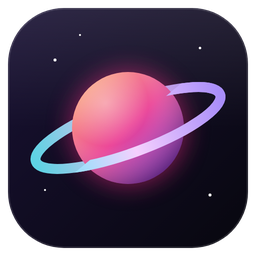
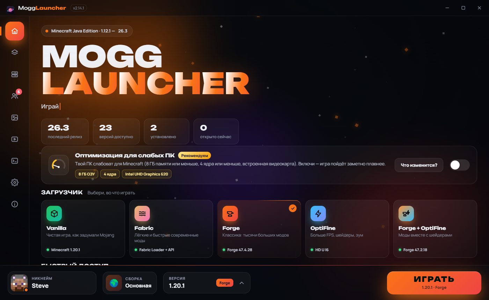
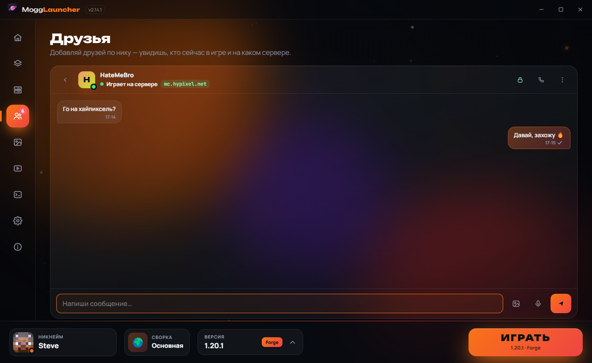
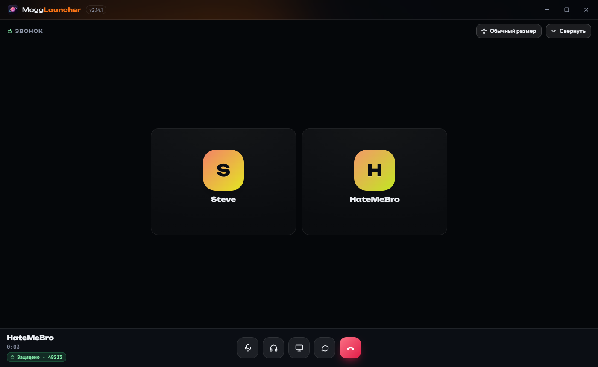
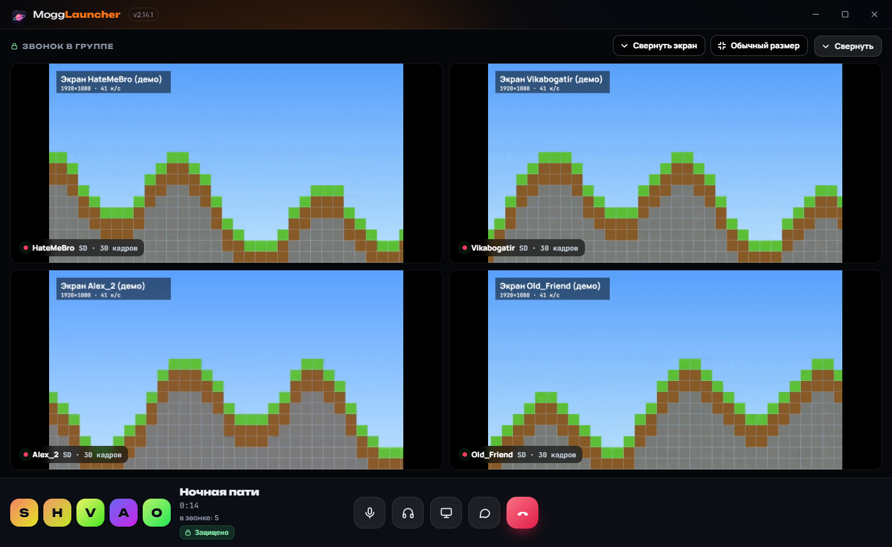
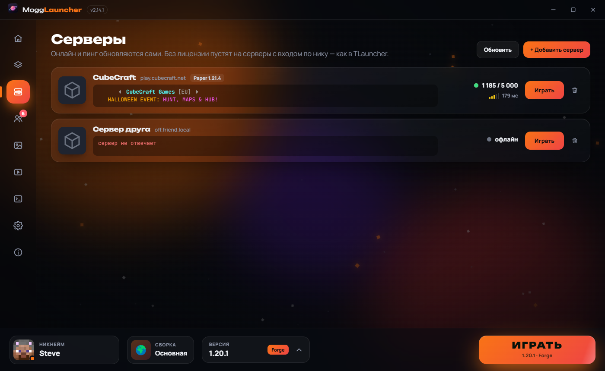

  

<h1 align="center">Mogg Launcher</h1>

  Бесплатный лаунчер Minecraft для Windows: все версии, моды в один клик, оптимизация для слабых ПК, 
  друзья, голосовые звонки и демонстрация экрана прямо в лаунчере.

  <a href="https://mogglauncher.fun"><b>Скачать на mogglauncher.fun</b></a> ·
  <a href="https://t.me/MoggLauncher">Telegram</a> ·
  <a href="https://discord.gg/GNxNYzQY8">Discord</a>

## Возможности

- **Все версии Minecraft** — от 1.12.1 до самой новой, Java скачивается сама.
- **Fabric, Forge и OptiFine в один клик** — без ручной установки и поиска файлов.
- **Оптимизация для слабых ПК** — лаунчер сам подбирает моды и настройки, игра идёт заметно плавнее.
- **Сборки** — отдельные наборы модов для разных игр, обмен сборкой с другом по короткому коду.
- **Друзья и чат** — видно, кто в игре и на каком сервере; сообщения, голосовые и скриншоты.
- **Голосовые звонки** — друзьям и в группах, с шумоподавлением на нейросети.
- **Демонстрация экрана** — весь монитор или окно программы, HD и 60 кадров, до четырёх экранов сразу.
- **Совместная игра без своего сервера** — открой мир, друг зайдёт к тебе через интернет.
- **Сквозное шифрование** — переписку и звонки видите и слышите только вы, даже наш сервер их не прочитает.
- **Скины, серверы, скриншоты, живые фоны меню** и три языка: русский, украинский, английский.

## Скриншоты

| Друзья и чат | Голосовой звонок |
|---|---|
|  |  |

| Демонстрация экрана в группе | Серверы |
|---|---|
|  |  |

## Установка

1. Зайди на [mogglauncher.fun](https://mogglauncher.fun) и нажми «Скачать».
2. Запусти установщик — права администратора не нужны.
3. Придумай ник и играй. Лаунчер сам обновляется до новых версий.

Проверка на вирусы: [VirusTotal — 0 из 70](https://www.virustotal.com/gui/file/37e65bc3d8dd759dc7611051c488d81d67df54dae6d02591c55646c043e94730).

---

### English

**Mogg Launcher** is a free Minecraft launcher for Windows: every version from 1.12.1 to the latest, Fabric / Forge / OptiFine in one click,
performance tuning for low-end PCs, profiles, friends and chat, voice calls, HD 60 fps screen sharing and end-to-end encryption.
Download it at **[mogglauncher.fun](https://mogglauncher.fun)**.

Mogg Launcher is not affiliated with Mojang Studios or Microsoft. Minecraft is a trademark of Mojang Synergies AB.
